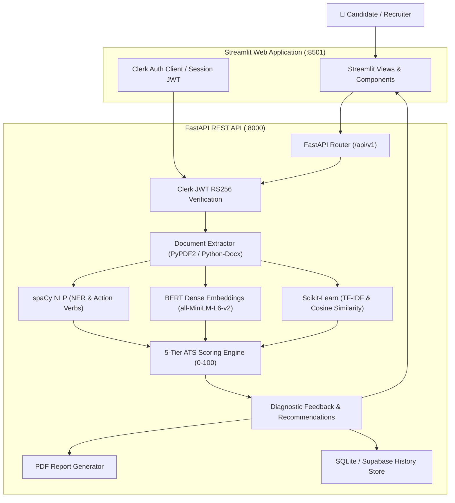

# 🎯 ATS Resume Scorer & Analyzer

> Production-grade Applicant Tracking System (ATS) Resume Analyzer built from scratch with **BERT (Bidirectional Encoder Representations from Transformers)**, **FastAPI**, **Streamlit**, **spaCy**, **Scikit-Learn**, **Clerk Authentication**, **PyPDF2**, and **Python-Docx**. Supports deployment to **AWS Elastic Beanstalk** and **Vercel**.

---

## 🌟 Key Features

- **BERT Bidirectional Semantic Similarity**: Encodes candidate resumes and job descriptions using deep transformer embeddings (`sentence-transformers/all-MiniLM-L6-v2` / `bert-base-uncased`) evaluated via Scikit-Learn Cosine Similarity.
- **Skill-to-Project Validation Engine**: Mathematically cross-references claimed candidate skills against project bullets and work history using BERT dense embeddings to eliminate keyword stuffing.
- **spaCy Linguistic Analysis**: POS-tagging extracts assertive action verbs; Named Entity Recognition (NER) identifies location entities (`GPE`, `LOC`) for privacy compliance.
- **Scikit-Learn TF-IDF Matching**: Combines dense neural representations with n-gram TF-IDF keyword matrices.
- **Document Parsing (PyPDF2 & Python-Docx)**: High-fidelity document text extraction, table extraction, and embedded hyperlink parsing.
- **Clerk Authentication**: Robust session security with RS256 JWKS verification, with automated demo/guest mode for frictionless local testing.
- **Multi-Cloud Deployment Ready**: Preconfigured with `.ebextensions`, `Procfile`, and `Dockerrun.aws.json` for AWS Elastic Beanstalk, plus `vercel.json` for Vercel.
- **Automated PDF Report Generation**: Downloads professional PDF summaries with breakdown metrics and action checklists.

---

## 🏗️ Architecture



---

## 📁 Project Structure

```
ATS_SCORER/
├── backend/                  # FastAPI Application
│   ├── api/
│   │   ├── auth.py           # Clerk JWT verification (RS256 JWKS) & Demo Mode
│   │   └── routes.py         # Analysis, history, PDF, and health endpoints
│   ├── core/
│   │   └── config.py         # Environment configurations, weights, and thresholds
│   ├── database/
│   │   └── db.py             # SQLite persistence & Supabase integration
│   ├── models/
│   │   └── schemas.py        # Pydantic v2 schemas for requests & responses
│   ├── services/
│   │   ├── bert_service.py   # BERT semantic embedding & cosine similarity
│   │   ├── spacy_service.py  # spaCy NER, POS tagging, and action verbs
│   │   ├── resume_parser.py  # PyPDF2 and Python-Docx document extractors
│   │   ├── ml_matcher.py     # Scikit-Learn TF-IDF & hybrid matching
│   │   ├── ats_scorer.py     # 5-dimensional scoring engine
│   │   ├── feedback_engine.py# Granular issue diagnostics
│   │   ├── recommendation_engine.py # Prioritized action recommendations
│   │   ├── resume_analyzer.py# Complete analysis pipeline orchestrator
│   │   ├── report_generator.py # Jinja2 HTML report generator
│   │   └── pdf_export.py     # PDF generation engine
│   ├── templates/            # HTML templates for report generation
│   ├── utils/                # File helpers, MIME detection, and fuzzy matching
│   └── main.py               # FastAPI entrypoint with model lifespan loading
├── frontend/                 # Streamlit User Interface
│   ├── .streamlit/           # Streamlit theme configuration
│   ├── assets/               # CSS stylesheets
│   ├── components/           # Modular Streamlit components
│   │   ├── clerk_auth.py     # Clerk login widget
│   │   ├── score_display.py  # Overall score card and breakdown bars
│   │   ├── skill_validation.py# BERT skill validation visualization
│   │   ├── jd_comparison.py  # Match % and keyword gap pills
│   │   ├── detailed_feedback.py # Expandable diagnostic cards
│   │   └── dashboard.py      # Unified dashboard view
│   ├── services/             # API client and Clerk authentication helpers
│   ├── views/                # Streamlit views (Landing, Scorer, History, Resources)
│   └── streamlit_app.py      # Streamlit main entrypoint
├── jupyter notebooks/        # Research & Model Experimentation
│   ├── 01_EDA_and_DATA_prep.ipynb  # Dataset exploratory analysis
│   ├── 02_BERT_EMBEDDINGS.ipynb    # BERT embeddings & cosine similarity
│   └── 03_BERT_FINETUNE.ipynb      # BERT fine-tuning with CosineSimilarityLoss
├── ml model/                 # Exported ML Artifacts
│   ├── bert_config.json      # BERT architecture & hyperparameter settings
│   ├── skills_taxonomy.json  # 500+ skills categorized taxonomy
│   ├── export_artifacts.py   # Script to re-export artifacts
│   └── README.md
├── .ebextensions/            # AWS Elastic Beanstalk configuration
│   └── 01_fastapi.config
├── Procfile                  # AWS Elastic Beanstalk process definition
├── Dockerrun.aws.json        # AWS Elastic Beanstalk Docker deployment
├── vercel.json               # Vercel Serverless configuration
├── api/
│   └── index.py              # Vercel entrypoint
├── requirements.txt          # Combined dependencies
└── .env.example              # Environment variables template
```

---

## 📖 User Manual & Quick Start Guide

### ⚡ One-Line Terminal Setup (Download + Install + Run Backend & Frontend)

Run a single command below to download the entire source code, install all dependencies, start the **FastAPI Backend** (`http://localhost:8000`), and launch the **Streamlit Web App** (`http://localhost:8501`) in your browser:

**Windows (PowerShell):**
```powershell
git clone https://github.com/ShreyasNakode/ATS-Resume-Scorer.git; cd "ATS-Resume-Scorer\ATS_SCORER"; pip install -r requirements.txt; python -m spacy download en_core_web_md; Start-Process powershell -ArgumentList "-NoExit", "-Command", "python -m uvicorn backend.main:app --host 0.0.0.0 --port 8000 --reload"; python -m streamlit run frontend/streamlit_app.py
```

**Windows (Command Prompt / CMD):**
```cmd
git clone https://github.com/ShreyasNakode/ATS-Resume-Scorer.git && cd ATS-Resume-Scorer\ATS_SCORER && pip install -r requirements.txt && python -m spacy download en_core_web_md && start cmd /k "python -m uvicorn backend.main:app --host 0.0.0.0 --port 8000 --reload" && python -m streamlit run frontend/streamlit_app.py
```

**Linux / macOS / Git Bash:**
```bash
git clone https://github.com/ShreyasNakode/ATS-Resume-Scorer.git && cd ATS-Resume-Scorer/ATS_SCORER && pip install -r requirements.txt && python -m spacy download en_core_web_md && (python -m uvicorn backend.main:app --host 0.0.0.0 --port 8000 --reload &) && python -m streamlit run frontend/streamlit_app.py
```

---

### 🛠️ Step-by-Step Setup

### 1. Clone & Set Up Virtual Environment

```bash
git clone https://github.com/ShreyasNakode/ATS-Resume-Scorer.git
cd ATS-Resume-Scorer/ATS_SCORER
python -m venv venv
venv\Scripts\activate       # On Linux/macOS: source venv/bin/activate
```

### 2. Install Dependencies

```bash
pip install -r requirements.txt
python -m spacy download en_core_web_md
```

### 3. Environment Configuration

Copy `.env.example` to `.env`:
```bash
cp .env.example .env
```
*(The app runs out-of-the-box in local demo mode even without setting up third-party keys).*

### 4. Run the FastAPI Backend

```bash
python -m uvicorn backend.main:app --host 0.0.0.0 --port 8000 --reload
```
- Interactive API Documentation: `http://localhost:8000/docs`
- Health Check: `http://localhost:8000/api/v1/health`

### 5. Run the Streamlit Frontend

In a separate terminal (with virtual environment activated):
```bash
python -m streamlit run frontend/streamlit_app.py
```
Open `http://localhost:8501` in your browser.

---

## 🔐 Clerk Authentication

This application integrates with **Clerk**:
1. Configure `CLERK_PUBLISHABLE_KEY` and `CLERK_JWKS_URL` in `.env`.
2. The FastAPI backend verifies the RS256 signature against Clerk's public JSON Web Key Set (`JWKS`).
3. If no key is provided, `ENABLE_DEMO_AUTH=true` allows one-click guest access for immediate evaluation.

---

## ☁️ Deployment

### AWS Elastic Beanstalk
1. Initialize Elastic Beanstalk CLI:
   ```bash
   eb init -p python-3.11 ats-resume-scorer
   ```
2. Create and deploy environment:
   ```bash
   eb create ats-scorer-env
   eb deploy
   ```

### Vercel
1. Install Vercel CLI: `npm i -g vercel`
2. Deploy directly:
   ```bash
   vercel
   ```
   *(Uses `vercel.json` and `api/index.py`)*

---

## 📊 Evaluation Metrics

The ATS score is calculated on a 0–100 scale:
- **Formatting & Structure (20 pts)**: Headers, bullets, reverse-chronological order.
- **Keywords & Technical Skills (25 pts)**: Density and alignment with target role.
- **Content Quality & Action Verbs (25 pts)**: Quantified achievements (metrics, %) and assertive verbs.
- **BERT Skill Validation (15 pts)**: Evidence of claimed skills substantiated in projects.
- **ATS Parsing Compatibility (15 pts)**: Clean single-column layout, privacy preservation.
